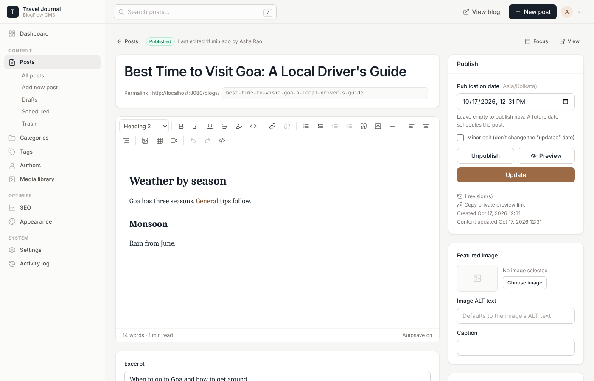

# BlogFlow CMS

A standalone, reusable PHP blog CMS that installs into a `/blogs/` folder of any existing PHP website —
with its own admin, editor, SEO system, image optimiser and theming, and without touching the main site.

| Blog article | Admin editor |
|---|---|
|  |  |

**The deployable product is the [`blogs/`](blogs/) folder.** Its [README](blogs/README.md) describes the
features, [DEPLOYMENT.md](blogs/DEPLOYMENT.md) covers Apache/Nginx installation and
[TROUBLESHOOTING.md](blogs/TROUBLESHOOTING.md) covers common problems.

## Repository layout

```
blogs/                deployable application (PHP 8.2+, MySQL/MariaDB) — upload this folder
  app/                Core (kernel, router, DB, auth, sessions, views), Controllers, Models,
                      Services (SEO, schema, media, sanitiser, redirects, menus, backup…), Views
  assets/             compiled CSS/JS and self-hosted fonts (built from src/)
  database/           migrations (applied automatically), reference schema.sql, sample seed.sql
  vendor/             production PHP dependencies (HTML Purifier, PHPMailer)
src/                  asset sources: Tailwind CSS, admin JS, Tiptap editor, public JS
scripts/build.mjs     asset build (Tailwind + esbuild + font copy)
scripts/package.sh    builds dist/blogflow-cms-<version>.zip
scripts/make-seed.php regenerates blogs/database/seed.sql (sample content)
tests/unit/run.php    dependency-free PHP unit tests
tests/e2e/            Playwright end-to-end workflows + fresh-site reset script
docs/                 Nginx snippet, screenshots
```

## Development

```bash
npm install                      # build tooling only (never needed on the server)
(cd blogs && composer install)   # PHP dependencies (committed in blogs/vendor for releases)
npm run build                    # CSS + JS + fonts → blogs/assets
npm run watch                    # rebuild on change
scripts/package.sh               # release zip (prunes vendor tests/docs, excludes runtime data)
```

Point an Apache vhost (with `AllowOverride All`) or Nginx (see `docs/nginx-blogs.conf`) at a document
root that contains `blogs/`, then open `/blogs/` to run the installer.

## Architecture decisions

- **No framework, small explicit core.** A front controller (`index.php`) → `Kernel` → `Router` →
  controller → `Response`. Services are created lazily per request (`App::service()`). Plain PHP
  templates with layouts/sections; every dynamic value is escaped with `e()`.
- **Installation-based reuse.** All site-specific values (URLs, branding, colours, menus, SEO
  templates) live in the database `settings` table, driven by a declarative schema
  (`SettingsSchema`) that also renders and validates the admin forms. No source edits per client.
- **Base path & canonical URL.** Routing uses the path the script is served from, so the folder name
  is irrelevant; all public URLs (canonical, sitemap, feed, OG) are built from the configured Blog URL.
- **Schema.** Normalised MySQL schema with a configurable table prefix, foreign keys, unique slugs and
  indexes for public queries (`deleted_at, status, published_at`). Datetimes are stored in UTC and
  shown in the site timezone. One primary category per post (used for URLs, breadcrumbs and schema)
  plus many tags; settings/theme/SEO values share one key-value table instead of three; roles are
  defined in code (`Auth::PERMISSIONS`) with two configurable author permissions.
- **Content safety.** The editor is Tiptap (MIT, self-hosted, bundled with esbuild). Its HTML is
  re-sanitised server-side with an HTML Purifier allowlist (figure/figcaption/mark, YouTube/Vimeo
  iframes only, `text-align` only). The editor always reloads from that sanitised HTML; the Tiptap
  JSON is stored for reference. Rendering adds heading anchors, the TOC, responsive `<picture>`
  elements from the media library and safe link attributes.
- **Performance.** Public pages are server-rendered, cookie-free and cached as files (cleared on every
  content/settings change), with ETag/304 support. Scheduled posts publish via a cached “next due”
  timestamp — no cron needed. Public CSS is ~28 KB, public JS ~1.6 KB, fonts self-hosted with
  `unicode-range` and only the selected families are declared.
- **Images.** GD or Imagick, capabilities detected at runtime (AVIF only when truly supported).
  Uploads are validated by content, re-encoded (stripping metadata), EXIF-rotated, resized without
  upscaling and stored with responsive sizes and WebP/AVIF derivatives. Private originals allow
  lossless bulk re-optimisation in resumable batches.
- **Security.** CSRF on every admin POST, strict admin CSP (no inline scripts), hardened sessions,
  login throttling, permission checks per route, prepared statements with multi-statement execution
  disabled, deny rules for private folders, script-free uploads, allowlisted backup restore,
  SSRF-safe link checking, audit log.

## Verification

Tests were run in this repository's container against **Apache 2.4 + PHP 8.3.6 (mod_php)**,
**Nginx + PHP-FPM 8.3**, **MariaDB 10.11** and **Chromium (Playwright)**.

```bash
php tests/unit/run.php                       # 25 unit tests
tests/e2e/reset-site2.sh                     # fresh copy at /var/www/site2/blogs + empty DB
node tests/e2e/workflows.mjs                 # 129 browser + HTTP checks
```

`workflows.mjs` runs against a **fresh, uninstalled copy** served on a different host
(`blog.test:8081`), a new database (`blogflow2`) and table prefix (`cms_`), with PHP
`open_basedir` restricted to the `/blogs/` folder (proving nothing is loaded from the parent
website). It was also run against the contents of the packaged release zip. Covered: installer
(including wrong-password and weak-password handling) and lock; unauthenticated access, CSRF,
security headers; login and session cookie flags; category, author (with photo upload), media
uploads (resize, WebP, responsive sizes, EXIF rotation, PNG alpha, rejection of disguised scripts),
single and bulk optimisation; post creation in the real editor (headings, links via the dialog,
lists, image with ALT/width, table, FAQ, SEO fields, live analysis); draft, private preview (noindex,
token-protected), publish; one H1, `<picture>`/srcset, lazy/eager images, `rel` on external links;
title/description/canonical/robots/OG/X/article tags; JSON-LD structure; sitemap and RSS; slug change
→ 301, trailing-slash 301, 404s, `/page/1` redirect, out-of-range pagination 404; theme colours with
live preview; external menu link; mobile layouts at 390 px (no horizontal scroll, menu toggle,
admin editor); editing with revisions and diff; trash/restore; configuration export (secrets
excluded) and import; scheduling without cron; SEO audit; database backup download and protection;
PHP in `uploads/` never executed; password reset links (single-use, sessions revoked).

Also verified manually in this environment: database restore from a BlogFlow backup (with automatic
safety backup), rejection of a tampered backup containing a foreign statement, the CLI tools, and the
Nginx rules in `docs/nginx-blogs.conf` (routing, deny rules, image-only uploads).

**Not verified here** (no access in this environment — please check on your hosting):

- Real shared hosting (cPanel/LiteSpeed), FTP upload, and MySQL 8 specifically (MariaDB 10.11 was
  used; the SQL is standard MySQL 5.7+/8 syntax). PHP 8.2 itself (8.3 was used; the code avoids
  8.3-only features and Composer is pinned to the 8.2 platform).
- The Imagick driver and AVIF output (the container's GD has no AVIF support, so AVIF was correctly
  reported as unavailable and skipped).
- Actual email delivery (PHP `mail()`/SMTP) for password-reset emails; the reset link flow itself is
  tested.
- External link checking over the internet, Google's Rich Results Test / Search Console processing,
  Lighthouse/Core Web Vitals measurements, browsers other than Chromium, and screen-reader testing.
  Accessibility was addressed by design (semantic landmarks, skip link, focus styles, labelled
  controls, WCAG contrast checks on presets) but not audited with assistive technology.
